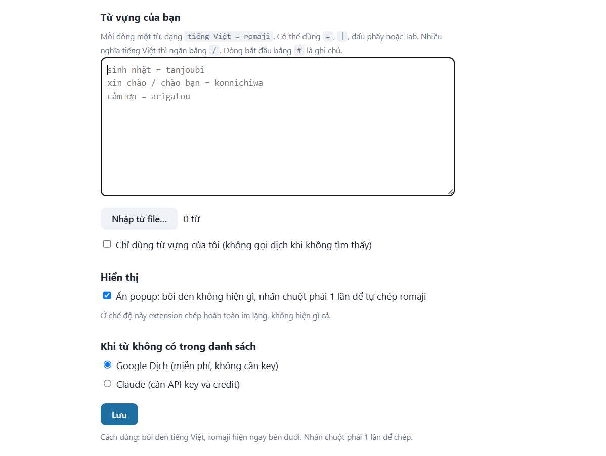

# Romaji Popup

Tiện ích Chrome giúp bạn **bôi đen tiếng Việt để lấy romaji tiếng Nhật**, dùng để gõ đáp án khi học tiếng Nhật. Romaji hiện thành một ô nhỏ ngay dưới chỗ bôi đen, và chỉ cần nhấn chuột phải một lần là chép vào clipboard.

## Tính năng

- **Popup nhỏ gọn:** bôi đen một từ hoặc cụm từ (tối đa 100 ký tự) là romaji hiện ngay bên dưới.
- **Chép bằng một cú nhấn:** nhấn chuột phải một lần để chép romaji.
- **Chế độ ẩn:** bôi đen không hiện gì, nhấn chuột phải là chép im lặng.
- **Từ vựng riêng:** tự nạp danh sách từ, extension tra theo danh sách này trước, nên không bị dịch sai.
- **Hai nguồn dịch dự phòng:** Google Dịch (miễn phí, không cần key) hoặc Claude (cần API key).
- **Romaji kiểu gõ bàn phím tiếng Nhật:** `ん` cuối từ được viết `nn`, các từ được viết liền không có khoảng trắng, trường âm `ー` viết bằng dấu `-`.
- **Có bộ nhớ đệm:** kết quả từ Google hoặc Claude được lưu tối đa 200 mục, bôi đen lại cùng cụm thì không gọi lại.

## Cài đặt

Extension chưa lên Chrome Web Store, bạn cài thủ công như sau:

1. Tải mã nguồn về (`git clone` hoặc tải file zip rồi giải nén).
2. Mở `chrome://extensions` và bật **Developer mode** ở góc trên bên phải.
3. Bấm **Load unpacked** rồi chọn thư mục của dự án (thư mục có file `manifest.json`).
4. Bấm vào icon extension để mở trang cài đặt.
5. Tải lại các tab đang mở, vì extension chỉ chạy trên trang được mở sau khi cài.

## Cách dùng

1. Bôi đen một từ tiếng Việt trên bất kỳ trang web nào.
2. Romaji hiện ngay dưới vùng bôi đen.
3. Nhấn chuột phải một lần để chép. Menu chuột phải bị chặn trong lúc có từ được bôi đen, muốn dùng menu thì bấm ra chỗ khác hoặc nhấn `Esc` để bỏ bôi đen.

## Cài đặt trong extension

Bấm icon extension để mở trang cài đặt:



| Mục | Ý nghĩa |
|---|---|
| **Từ vựng của bạn** | Danh sách từ tự nạp, được tra trước tiên. |
| **Chỉ dùng từ vựng của tôi** | Không gọi dịch khi từ không có trong danh sách, popup sẽ không hiện gì. |
| **Ẩn popup** | Bôi đen không hiện gì, nhấn chuột phải là chép im lặng. |
| **Nguồn dịch dự phòng** | Google Dịch (mặc định) hoặc Claude. |
| **Anthropic API key** | Chỉ cần khi chọn Claude. |

### Định dạng từ vựng

Mỗi dòng một từ, dạng `tiếng Việt = romaji`:

```
sinh nhật = tanjoubi
xin chào / chào bạn = konnichiwa
ngôn ngữ = ~go
cảm ơn = arigatou
# dòng bắt đầu bằng # là ghi chú
```

- Dấu ngăn giữa tiếng Việt và romaji có thể là `=`, `|`, `;`, dấu phẩy hoặc Tab, nên dán thẳng từ Excel hoặc CSV được.
- Một từ có nhiều cách nói tiếng Việt thì ngăn bằng `/`.
- Có nút **Nhập từ file** cho file `.txt`, `.csv`, `.tsv`.
- Khi tra, extension không phân biệt hoa thường, bỏ dấu câu và dấu `~`, nhưng **phải đúng dấu tiếng Việt**.
- Bôi đen cả câu thì extension ghép từ các cụm có trong danh sách (cụm dài nhất trước). Chỉ cần một từ không có thì cả câu coi như không có trong danh sách.

## Cách hoạt động

```
Bôi đen ──► content.js ──► background.js
                              │
                              ├─ 1. Tra từ vựng của bạn
                              ├─ 2. (nếu không thấy) Google Dịch hoặc Claude
                              └─ 3. Chuẩn hóa romaji (nn, bỏ khoảng trắng)
                                      │
            popup / chép ◄── content.js
```

- `content.js` bắt sự kiện bôi đen, hiện popup (trong Shadow DOM nên không bị CSS của trang ảnh hưởng) và xử lý nhấn chuột phải.
- `background.js` (service worker) tra từ vựng và gọi dịch, nên API key không lộ ra trang web.

## Cấu trúc thư mục

```
romaji-extension/
├── manifest.json     # Cấu hình extension (Manifest V3)
├── background.js     # Tra từ vựng, gọi Google Dịch / Claude
├── content.js        # Popup và chép romaji
├── options.html      # Trang cài đặt
├── options.js        # Logic trang cài đặt
├── docs/
│   └── options.png   # Ảnh chụp trang cài đặt (dùng trong README)
└── README.md
```

## Quyền riêng tư

- Extension xin quyền `storage`, và quyền truy cập `translate.googleapis.com` và `api.anthropic.com`. Content script chạy trên mọi trang để bắt thao tác bôi đen.
- Văn bản bạn bôi đen **chỉ được gửi đi** khi không có trong từ vựng của bạn (và bạn chưa bật "Chỉ dùng từ vựng"): tới Google Dịch hoặc tới Anthropic tùy nguồn bạn chọn. Từ có trong danh sách thì tra ngay trong máy, không gửi đi đâu.
- API key và từ vựng lưu trong `chrome.storage.local` trên trình duyệt của bạn. Key không nằm trong mã nguồn, nhưng đừng chia sẻ thư mục hồ sơ Chrome của bạn.

## Hạn chế

- Google Dịch được gọi qua một đường dẫn không có tài liệu chính thức, nên có thể bị chặn tạm khi gọi quá nhiều hoặc đổi cách hoạt động sau này.
- Romaji của Google theo kiểu đọc chuẩn (trợ từ は là `wa`), khác với kiểu gõ bàn phím (`ha`). Muốn chắc chắn thì thêm từ vào danh sách từ vựng.
- Chỉ hỗ trợ chiều Việt sang Nhật.
- Chỉ chạy ở khung trang chính, chưa hỗ trợ bôi đen bên trong iframe.
- Không chạy trên các trang đặc biệt của Chrome như `chrome://` hay Chrome Web Store.
- Nguồn Claude dùng model `claude-haiku-5-5`, đổi ở hằng số `MODEL` trong `background.js` nếu cần. Gọi Claude cần API key và credit trong Anthropic Console.

## Phát triển

Sau khi sửa code, vào `chrome://extensions` bấm nút tải lại ở extension, rồi tải lại tab đang mở. Với trang cài đặt thì mở lại trang đó.

## Giấy phép

Chưa chọn giấy phép. Nếu muốn mở mã nguồn, hãy thêm file `LICENSE` (ví dụ MIT) vào dự án.
